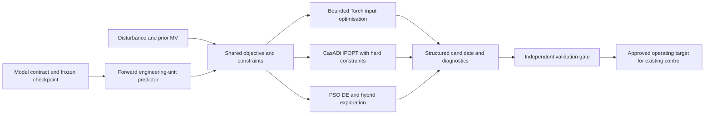
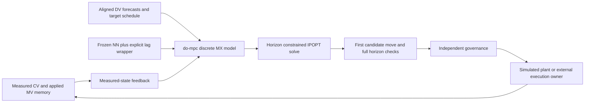
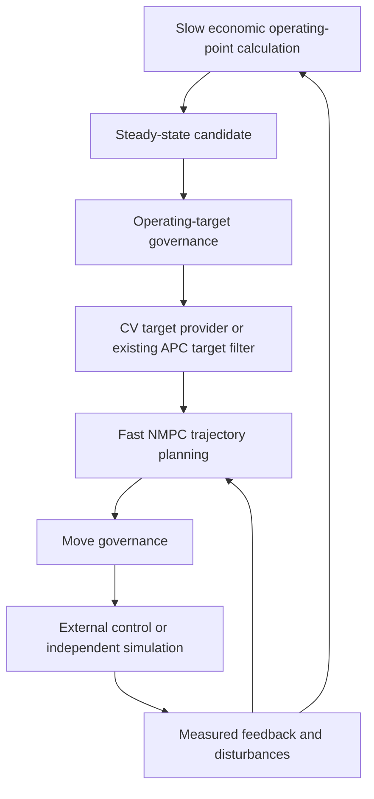
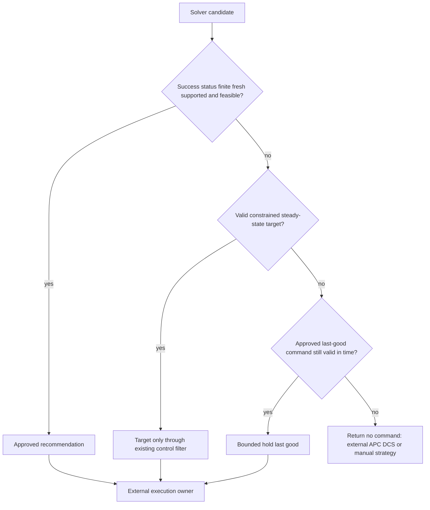

# AiPC Architecture

This is an installable research framework around the existing frozen forward
predictor, not an inverse network, plant controller or certified safety system.
The compact package separates responsibilities in working modules rather than
creating a mostly empty nested module tree.

## Steady-state inverse optimisation

The inverse layer answers **where to operate**. Its steady-state interpretation
is provisional because the existing static network was fitted to lagged noisy
outputs. All solvers use the same engineering predictor and objective module.
The legacy notebook objective remains available unchanged for compatibility.

## Dynamic NMPC

NMPC answers **how to move**. The current states are measured CVs plus applied
MV memory. MV memory is updated from the actual approved move, not the solver's
previous suggestion. Forecasts supply N+1 rows. Native CasADi operations provide
exact model derivatives; no opaque callbacks or ONNX approximation are used.

## Combined Hybrid Architecture

An integration owner can supply the accepted steady-state predicted CVs through
`ForecastProvider.constant(steady_state_result.outputs, t_step)`, or a schedule,
to the controller. A raw steady-state MV recommendation is **not** a validated
dynamic trajectory. The default demonstration uses a fixed CV target followed
by a target step; it does not claim an online plant economic coordinator.

## Runtime Governance

No module contains an OPC-UA client, DCS write, network upload, SIS bypass or
plant-write operation. `GateDecision.tier` distinguishes a target-only release
from an NMPC move. External control retains authority at all times.

## Ownership

| Module | Responsibility |
|---|---|
| model | YAML mapping, signal/scaler contract, trusted checkpoint, feature assembly |
| conversion | Native CasADi expressions and full prediction/Jacobian parity |
| optimization | Shared cost, bounds, feasibility, results, Torch/IPOPT multistart |
| mpc | Forecasts, temporary dynamics, state feedback, discrete do-mpc controller |
| governance | Independent finite/freshness/status/envelope/constraint gate and fallback |
| benchmarking | PSO/DE/hybrid adapters, repeated static metrics, closed-loop metrics |
| simulation | Original synthetic plant extraction and deliberately mismatched replay |
| reporting | Offline Matplotlib artifact generation only |
| cli | Root-independent commands and holdout scenario selection |

Library code does not reseed global RNGs or alter global Torch thread settings.
PSO, multistart and simulation use local seeded NumPy generators. Plotting's Agg
backend is imported only by the simulation reporting workflow.